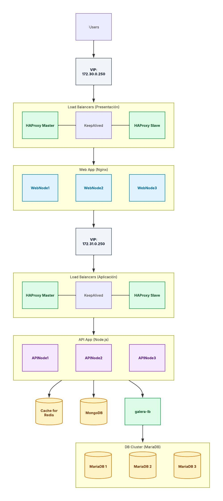
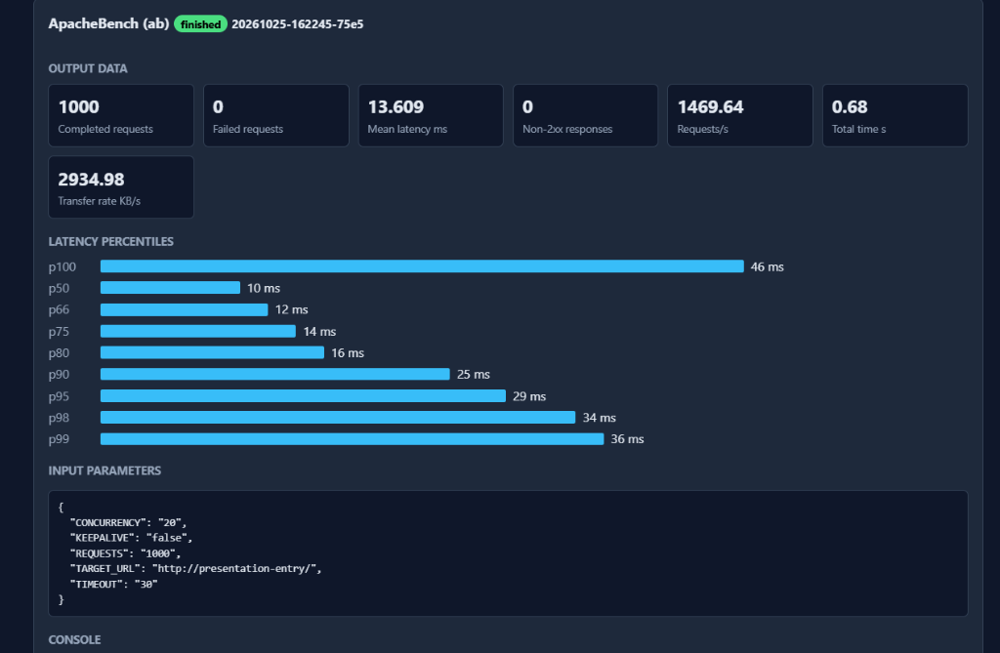
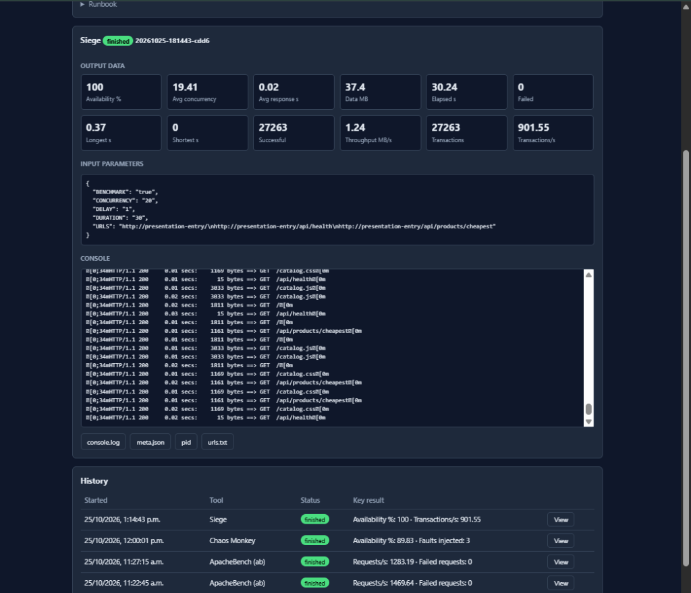
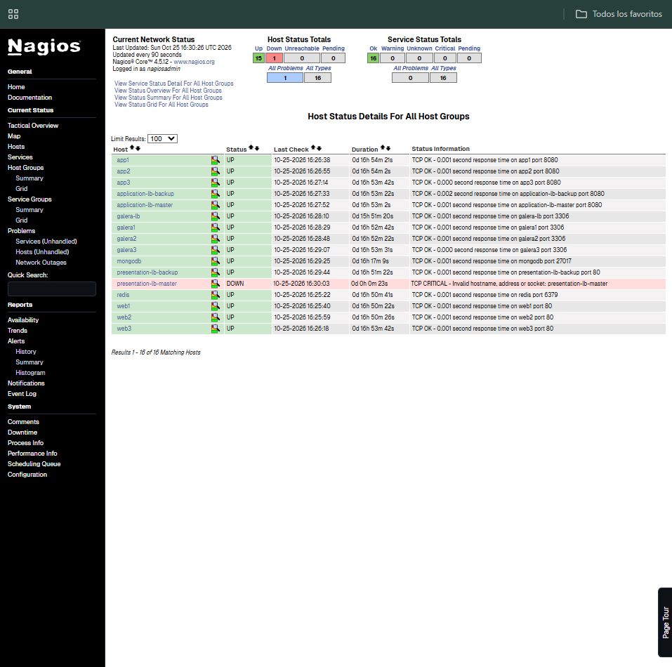
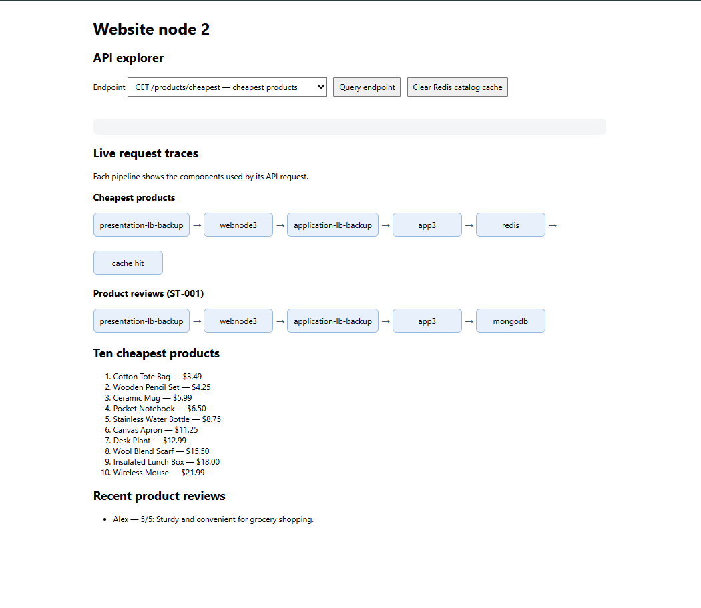
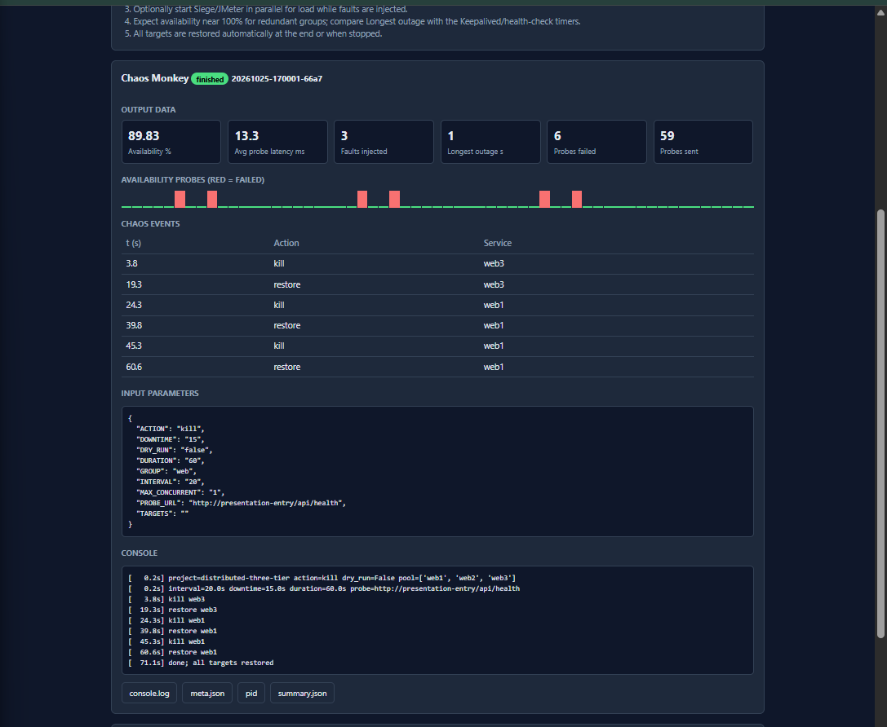
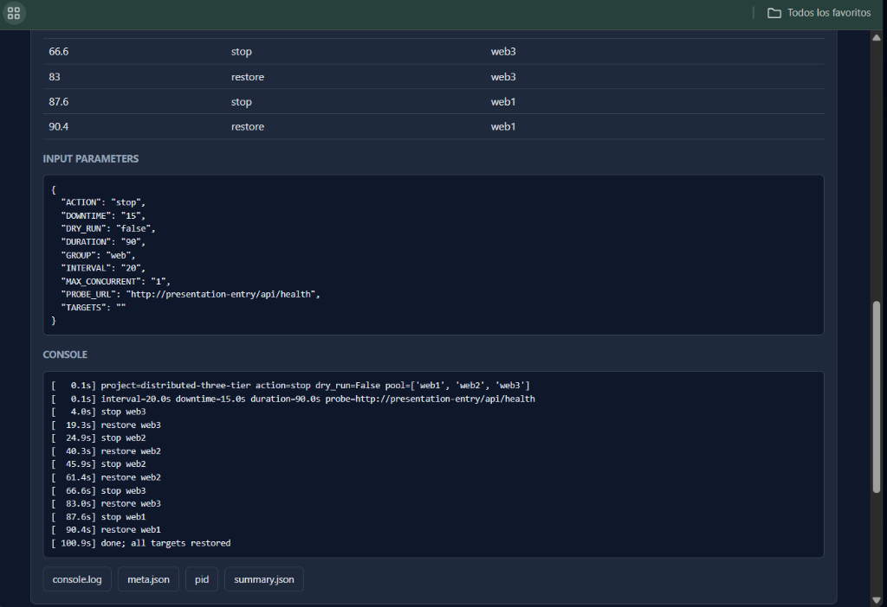
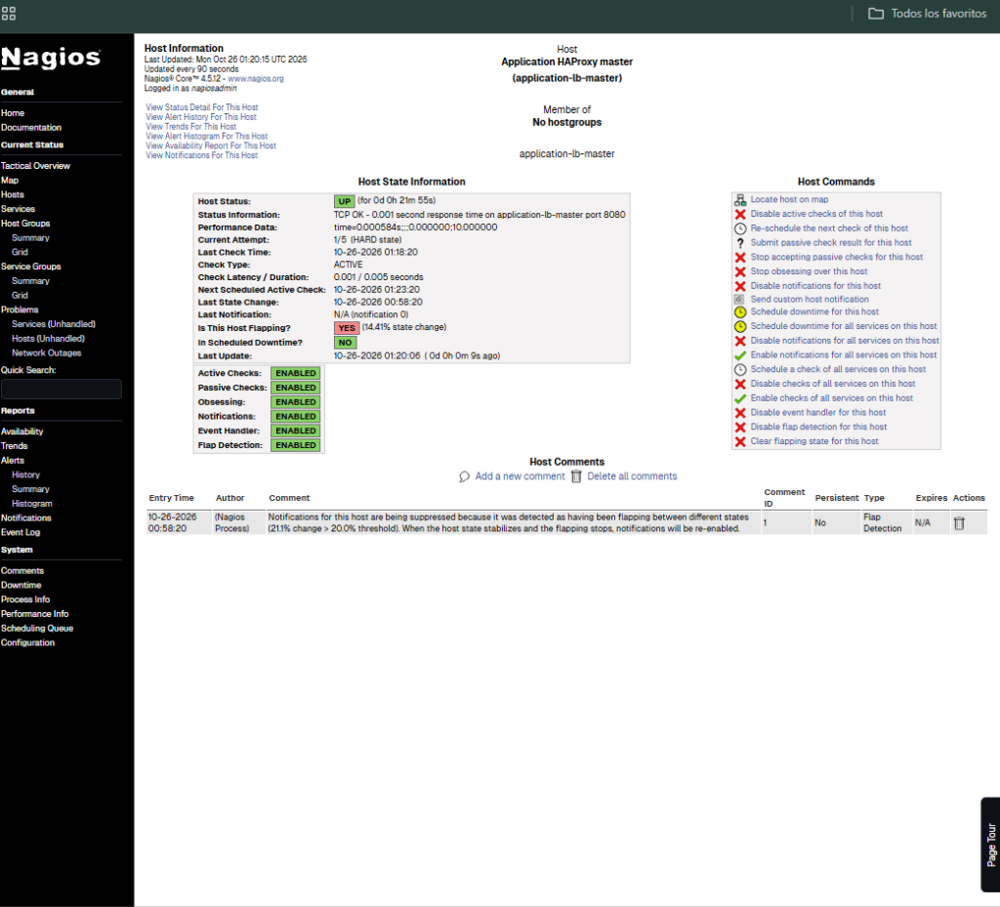

# Sistema distribuido de 3 capas: de Docker Compose a Kubernetes

Proyecto de la materia Sistemas Distribuidos. Es una tienda en línea con catálogo y reseñas, armada en tres capas (presentación, aplicación y datos) y diseñada para que ningún componente sea un punto único de falla (SPOF). Se hizo en dos partes: primero con Docker Compose y después migrada a Kubernetes.

| Parte | Autoría | Repositorio |
|---|---|---|
| 1. Docker Compose (tarea #995, arquitectura de 3 capas resiliente y tolerante a fallos) | Jose Angel Mendez | [JoseMendez07/sistemadistribuidode3capas](https://github.com/JoseMendez07/sistemadistribuidode3capas) |
| 2. Migración a Kubernetes (K3s, Flux, Terraform y GitHub Actions) | Bradle Heziel Ake Canul | [Bradbd08/sistemas-distribuidos-tienda-k8s](https://github.com/Bradbd08/sistemas-distribuidos-tienda-k8s) |

Este repositorio y todo el trabajo de la Parte 2 son de Bradle Heziel Ake Canul: manifiestos de Kubernetes, GitOps con Flux, Terraform, CI/CD, mensajería con RabbitMQ, observabilidad, seguridad, pruebas de desempeño y documentación.

## Dónde está cada cosa

| Qué | Dónde |
|---|---|
| Parte 1: Compose, HAProxy, Keepalived, Nagios y laboratorio de resiliencia | `docker-compose.yml`, `haproxy/`, `keepalived/`, `nagios/`, `resilience-lab/` |
| API en Node.js, web (nginx) y worker | `application/`, `web/`, `worker/` |
| Manifiestos de Kubernetes (Kustomize) | `deploy/` |
| Flux por entorno (dev y prod) | `clusters/` |
| Terraform | `infra/` |
| Secretos cifrados con SOPS | `credentials/` |
| Scripts auxiliares | `scripts/` |
| Documentación de la Parte 2 | `docs/` (índice en [docs/README.md](docs/README.md)) |
| Resultados de desempeño | [docs/resultados/](docs/resultados/README.md) |
| Cómo levantar todo, versiones y verificaciones | [REQUIREMENTS.md](REQUIREMENTS.md) |

## Resultados de desempeño

| Prueba | Parte 1 (Compose) | Parte 2 (K3s, dev) |
|---|---|---|
| ApacheBench, 1,000 peticiones, concurrencia 20, ruta `/` | 1,469.64 req/s, p95 29 ms, p99 36 ms | 7,914 req/s, p95 4 ms, p99 5 ms |
| Siege, 30 s, 20 usuarios, 3 rutas | 901.55 trans/s, 100 % de disponibilidad | 3,491 trans/s, 100 % |
| Siege, 120 s, 50 usuarios, 3 rutas | no se midió | 3,668 trans/s, 100 % |

Las dos partes se midieron en sesiones distintas y con distinta configuración: la tabla es una referencia, no una comparación exacta. El detalle, las salidas crudas y el escalado automático (HPA) están en [docs/resultados/README.md](docs/resultados/README.md).

## Parte 2: Kubernetes

La Parte 2 lleva la misma tienda a un clúster K3s, con la infraestructura y los despliegues escritos como código.

* Imágenes: web (nginx), API (Node.js) y worker, sin root, publicadas en GHCR con firma (cosign) y SBOM.
* Manifiestos: Kustomize con una base y los overlays dev y prod.
* Datos: MariaDB Galera con MaxScale, MongoDB en replica set, Redis con Sentinel y RabbitMQ, todos con operadores.
* Reseñas asíncronas: la API publica en RabbitMQ y un worker las guarda en MongoDB, con reintentos y cola de errores (DLQ).
* Entrada: Traefik con TLS (cert-manager). Las escrituras piden contraseña y tienen límite de frecuencia.
* GitOps: Flux. dev sigue la rama `main` y prod sigue `release`, con un PR aprobado. Terraform prepara los nodos y arranca Flux. Los secretos van cifrados con SOPS (age).
* CI/CD: GitHub Actions con lint, pruebas, build, Trivy, kubeconform y Terraform.
* Observabilidad: OpenTelemetry con Grafana, Loki, Tempo y Mimir, más tableros y alertas.
* Seguridad: Pod Security `restricted`, NetworkPolicies de denegación por defecto y usuarios de mínimo privilegio en las bases de datos.

Estado al 2026-11-24:

* El clúster dev (k3d, 3 servidores en una laptop) está probado de punta a punta: las 8 Kustomizations de Flux en `True` y la tienda responde 200.
* El clúster real de 2 laptops, con un nodo por laptop, está en preparación (REQUIREMENTS.md, sección 6).
* Quedaron fuera, con la decisión escrita en [docs/05-seguridad.md](docs/05-seguridad.md): Wazuh, Kyverno, kube-bench, contraseña de Redis y usuario propio de RabbitMQ.

Las etapas y su estado están en [docs/README.md](docs/README.md).

## Cómo levantar la Parte 1 (Docker Compose)

```bash
git clone https://github.com/Bradbd08/sistemas-distribuidos-tienda-k8s.git
cd sistemas-distribuidos-tienda-k8s

# 1) Crear el .env con contraseñas al azar (si ya tienes un .env de la Parte 1, úsalo y salta este paso)
while IFS= read -r l; do
  case "$l" in *change-this-*) echo "${l%%=*}=$(openssl rand -hex 16)" ;; *) echo "$l" ;; esac
done < .env.example > .env && chmod 600 .env

# 2) Levantar todo (la primera vez tarda unos 50 segundos)
docker compose up -d --build

# 3) Levantar el laboratorio de pruebas (después del paso 2: usa su red)
(cd resilience-lab && docker compose up -d --build)
```

Puntos de entrada:

* Tienda web (catálogo y reseñas): `http://localhost`
* API: `http://localhost/api/health`
* Nagios Core: `http://localhost:8088/nagios`, usuario `nagiosadmin` y clave en `NAGIOSADMIN_PASSWORD` del `.env`
* Laboratorio de resiliencia: `http://localhost:8090`

Para apagar sin perder datos, primero el laboratorio y luego el stack, sin `-v`:

```bash
(cd resilience-lab && docker compose down) && docker compose down
```

## Cómo levantar la Parte 2 (Kubernetes)

El modo desarrollo (K3s dentro de Docker con k3d) está en la sección 5 de [REQUIREMENTS.md](REQUIREMENTS.md). El clúster real, con un nodo por laptop, está en la sección 6. Compose y el clúster dev no caben a la vez en una laptop de 15 GiB: apaga uno antes de encender el otro.

## Parte 1: reporte de la práctica (Jose Angel Mendez)

### Objetivos

* Alta disponibilidad: la plataforma sigue operando aunque caigan de golpe balanceadores, servidores web o nodos de base de datos.
* Resiliencia: los componentes caídos se recuperan y se reintegran al clúster solos, sin que el usuario lo note.
* Escalabilidad y balanceo: las peticiones concurrentes se reparten de forma equilibrada entre varias réplicas en cada capa.
* Validación: pruebas de estrés (ApacheBench y Siege), de conmutación por error (failover) y de inyección de fallos (Chaos Monkey).

Para lograrlo se combinan contenedores Docker orquestados con Docker Compose, balanceadores HAProxy, redundancia activa/pasiva con Keepalived (VRRP), microservicios en Node.js, tres bases de datos (Redis, MongoDB y MariaDB Galera Cluster) y monitoreo en tiempo real con Nagios Core.

### Arquitectura

Este es el diagrama que diseñé para el proyecto:



Flujo de datos y conectividad por capa:

1. Capa de presentación (subred `172.30.0.0/24`):
   * El cliente entra por la IP virtual (VIP) `172.30.0.250`, en el puerto 80.
   * Un par Keepalived en modo VRRP administra la VIP: `presentation-lb-master` (prioridad 101) y `presentation-lb-backup` (prioridad 100).
   * El HAProxy activo reparte las solicitudes en round-robin entre 3 servidores Nginx (`web1`, `web2`, `web3`) que sirven la interfaz estática.

2. Capa de aplicación (subred `172.31.0.0/24`):
   * El tráfico hacia `/api/*` pasa por la segunda VIP, `172.31.0.250`.
   * Otro par HAProxy con Keepalived (`application-lb-master` y `application-lb-backup`) distribuye las peticiones hacia 3 servidores de API en Node.js con Express (`app1`, `app2`, `app3`).

3. Capa de datos y persistencia:
   * Redis 7 (caché en memoria): atiende las consultas de productos casi al instante. Tiene persistencia AOF para no perder datos al reiniciar.
   * MongoDB 8: guarda las reseñas en un Replica Set (`rs0`) con autenticación por `keyfile`.
   * MariaDB Galera Cluster: clúster multi-maestro síncrono de 3 instancias (`galera1`, `galera2`, `galera3`). A diferencia del repositorio base, se agregó un balanceador TCP dedicado, `galera-lb` (HAProxy en el puerto 3306), que reparte las conexiones SQL entre los nodos. En Compose la API todavía se conecta a `galera1` (`DB_HOST: galera1`).

4. Monitoreo y banco de pruebas:
   * Nagios Core (puerto 8088): vigila la salud de los 16 hosts del sistema.
   * Resilience Lab (puerto 8090): entorno aislado para pruebas de rendimiento y de caos.

### Mejoras del ToDo.md

Siguiendo el archivo `ToDo.md` del repositorio, apliqué estas soluciones:

| Punto | Componente | Reto | Solución |
| :---: | :--- | :--- | :--- |
| 2.1 | MongoDB | Replica Set y autenticación | Se inicializó el Replica Set `rs0` con un script de entrada automatizado. Se generó un archivo `keyfile` con permisos `chmod 400` y propiedad del usuario del sistema `mongodb:999`, para que los nodos se autentiquen entre sí de forma segura. |
| 2.2 y 2.3 | Redis | Pérdida de caché al reiniciar | Se activó la persistencia Append-Only File (AOF) con `--appendonly yes --appendfsync everysec`, sobre un volumen Docker persistente (`redis-data:/data`). |
| 3.0 | Galera Cluster | Punto único de falla y quórum | Se creó el servicio `galera-lb` (HAProxy TCP en el puerto 3306) para que las aplicaciones no dependan de una IP estática de MariaDB. También se configuró `MARIADB_GALERA_FORCE_SAFETOBOOTSTRAP: "yes"` para que el nodo bootstrap se recupere solo tras una falla abrupta. |

### Pruebas y resultados

#### Carga y rendimiento

ApacheBench (`ab`): 1,000 peticiones con concurrencia 20 contra la página principal.



* Peticiones completadas: 1,000
* Peticiones fallidas: 0 (100 % de éxito)
* Throughput: 1,469.64 peticiones por segundo (RPS)
* Latencia media: 13.609 ms (percentil 95 en 29 ms y percentil 99 en 36 ms)

Siege: una prueba sostenida de 30 segundos con 20 usuarios recurrentes que navegan entre `/`, `/api/health` y `/api/products/cheapest`.



* Transacciones totales: 27,263
* Throughput: 901.55 transacciones por segundo
* Disponibilidad: 100.00 % (0 fallas)
* Tiempo de respuesta medio: 0.02 segundos

#### Conmutación por error (failover)

Caída del balanceador maestro de presentación. Se detuvo a propósito el contenedor `presentation-lb-master`. Nagios Core marcó el estado crítico del master de inmediato y Keepalived pasó la IP virtual `172.30.0.250` a `presentation-lb-backup` en milisegundos:



Caída extrema. Para llevar la arquitectura al límite, simulé una catástrofe apagando al mismo tiempo 7 contenedores principales:

* `presentation-lb-master` (balanceador web master)
* `web1` y `web2` (2 de los 3 servidores Nginx)
* `application-lb-master` (balanceador de API master)
* `app1` y `app2` (2 de los 3 microservicios Node.js)
* `galera3` (1 nodo del clúster de base de datos)



* Resultado: la tienda siguió respondiendo y entregó el catálogo completo y las reseñas sin ningún error HTTP 502 o 503.
* Traza en vivo confirmada:
  $$\text{presentation-lb-backup} \longrightarrow \text{webnode3} \longrightarrow \text{application-lb-backup} \longrightarrow \text{app3} \longrightarrow \text{redis / mongodb}$$
  Con solo 1 balanceador web, 1 servidor web, 1 balanceador de API, 1 servidor de API y el quórum de la base de datos, el sistema siguió operando al 100 %.

#### Chaos engineering (Chaos Monkey)

Con el módulo Chaos Monkey del laboratorio de resiliencia configuré un experimento de 60 a 90 segundos con fallas al azar: se detuvieron servidores web activos, con intervalos de 20 s y 15 s de inactividad.



* Disponibilidad bajo ataque: 89.83 %
* Tiempo máximo de corte (longest outage): 1 segundo, lo que tarda el health check de HAProxy en detectar la caída y sacar el nodo del pool.
* Fallas inyectadas: 3 caídas forzadas sobre `web1` y `web3`.



* Autorecuperación: al terminar el ciclo de pruebas, el orquestador confirmó `[ 100.9s] done; all targets restored`. Todos los contenedores afectados volvieron y se reincorporaron solos al balanceador.

#### Monitoreo (Nagios Core)

Durante las pruebas de corte y recuperación, Nagios Core detectó las caídas y además activó su Flap Detection al ver que los balanceadores cambiaban de estado una y otra vez:



Así el monitoreo evita una avalancha de alertas cuando un nodo oscila y conserva el historial de eventos.

### Conclusiones

* Separar el balanceo web del balanceo de aplicaciones evita que la falla de un microservicio tire la entrega de las páginas estáticas o bloquee a los demás servicios.
* Keepalived con las IP virtuales `172.30.0.250` y `172.31.0.250` hizo que el cambio entre el balanceador master y el backup pasara sin que los usuarios lo notaran.
* La persistencia AOF en Redis evitó perder la caché en un arranque en frío.
* El sistema soportó la caída simultánea de más del 40 % de sus componentes sin perder funcionalidad.

### Correcciones al reporte original

Al actualizar este README (2026-11-24) se corrigieron tres datos que no coincidían con `docker-compose.yml`:

* Nagios está en el puerto 8088 y su clave sale del `.env`. El reporte decía puerto 8080 y clave `nagios`.
* La tienda solo publica el puerto 80. El reporte mencionaba también el 8000.
* La API de Compose se conecta a `galera1`. El reporte decía que repartía sus consultas con `galera-lb`.
